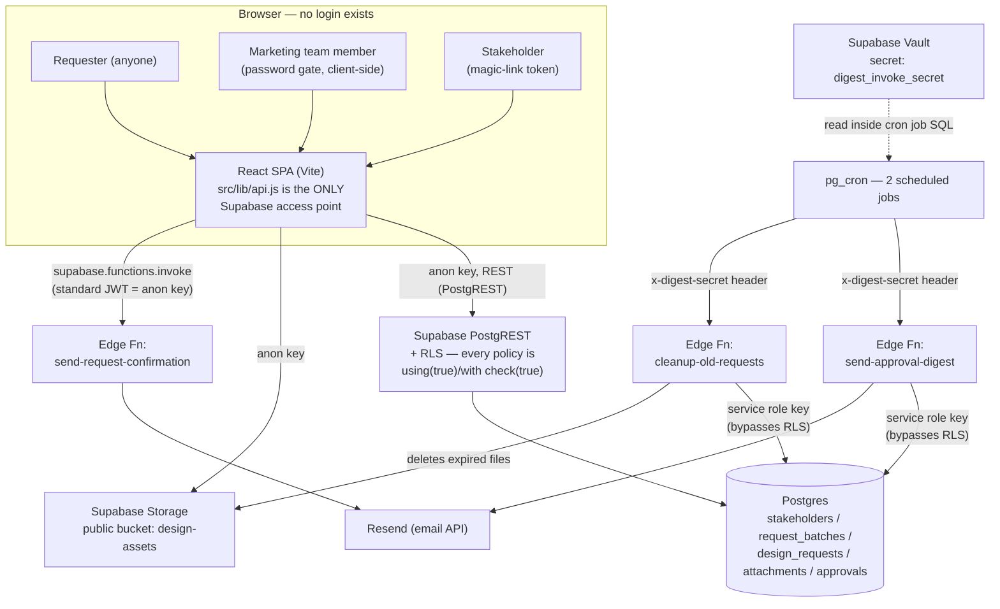

# Technical Audit — Design Request Tool

**Audit date:** 2026-10-28
**Scope:** Full codebase (frontend, Supabase backend, Edge Functions, SQL migrations, deployment config). No code was modified, refactored, or executed as part of this audit — all findings are from static inspection of the repository plus a small number of read-only data checks run in earlier working sessions (noted where relevant).
**Purpose:** Reference for planning integration into Zopper Marketing Studio (centralized Google Login + Upstash Redis RBAC: Viewer/Editor/Admin/Super Admin), without breaking existing workflows.

---

## 1. Application Overview

An internal single-page app that replaces an email/WhatsApp/spreadsheet workflow for requesting marketing design assets.

- **Purpose:** Business teams submit structured design requests; the design/marketing team tracks and fulfills them; a stakeholder approves the requirement up front and the final artwork afterward.
- **Explicit non-goals (by the original product brief):** no login/accounts, no kanban, no task assignment, no analytics/export.
- **"User types" today are informal, UI-level concepts, not accounts:**
  1. **Requester** — anyone who can reach `/submit`. Fully open, no gate at all.
  2. **Marketing/design team member** — reaches `/requests` and passes a client-side password gate (hardcoded allowlist of 5 emails + 1 shared password). Sees and manages *every* request.
  3. **Stakeholder** — reaches `/requests?token=...` via a personal link in an email. Sees only requests where they are the named approver.
- There is **no Supabase Auth, no sessions, no JWT tied to a real identity** anywhere in this app. All three "user types" share one Supabase `anon` API key.

---

## 2. Architecture Overview



### Current authentication / authorization flow (the two gates on `/requests`)

```mermaid
flowchart LR
  A["Visit /requests\n(no token in URL)"] --> B{"localStorage has a\nvalid team session?"}
  B -- no --> C["TeamLoginGate:\npick name from 5-email allowlist\n+ type shared password"]
  C -- "correct" --> D["Full management view:\nsee/manage ALL requests,\narchive, upload final design"]
  B -- yes --> D

  E["Visit /requests?token=...\n(from a digest email)"] --> F["RPC: resolve_stakeholder_by_token\n(requires stakeholders.active = true)"]
  F -- "match" --> G["Scoped view: only requests where\nstakeholder_id = this person\n(filtered in React, NOT by RLS)"]
  F -- "no match / inactive" --> H["\"Not accessible\" screen"]
```

Both gates are **entirely client-side**. Neither is backed by a Postgres policy that checks identity — see §6 and §8.

---

## 3. Frontend

| Aspect | Details |
|---|---|
| Framework | React 18, built with Vite 5, plain JavaScript (no TypeScript) |
| Styling | Tailwind CSS 3 |
| Routing | React Router 6, client-side only |
| Forms/validation | React Hook Form + Zod resolvers |
| Other deps | `@supabase/supabase-js` v2 (the only server client), `react-hot-toast`, `lucide-react`, `clsx` |

**Routes** (`src/App.jsx`):
- `/` → redirects to `/submit`
- `/submit` → `SubmitRequestPage` (fully open)
- `/requests` → `AllRequestsPage` (dual-mode — see above)
- `/approvals` → redirects to `/requests` + preserves query string (back-compat for already-sent email links)
- `*` → redirects to `/submit`

**Pages / primary flows:**
- `SubmitRequestPage` — 3-step wizard (`RequesterDetailsStep` → `DesignRequirementsStep` → `ReviewSubmitStep` → `SubmissionSuccess`). Draft state (text fields) persists in `sessionStorage`; `File` objects live in an in-memory module map (`src/lib/fileDraftStore.js`) keyed by a client-generated draft id — files do **not** survive a hard page reload.
- `AllRequestsPage` — branches into `TeamView` (table, filters, archive, 7/30/60-day range, detail drawer with status-change/upload panel) or `StakeholderView` (grouped cards: Requirement Approvals / Design Approvals / Completed) purely based on whether a stakeholder token is present.

**Component inventory:**
- `layout/` — `AppHeader`, `PageContainer`, `BackgroundShapes`
- `form/` — `RequesterDetailsStep`, `DesignRequirementsStep`, `DesignRequirementForm`, `FileUploader`, `RequestSummaryCard`, `ReviewSubmitStep`, `SubmissionSuccess`
- `requests/` — `RequestTable`, `RequestFiltersBar`, `RequestDetailDrawer` (+ `StatusUpdatePanel`), `TeamLoginGate`
- `approvals/` — `ApprovalCard` (shell), `RequirementApprovalCard`, `DesignApprovalCard`, `CompletedRequestCard`
- `ui/` — `Button`, `FormField`, `SelectField`, `ComboField` (editable combobox), `TextareaField`, `StatusBadge`, `EmptyState`, `LoadingState`, `ErrorState`, `ConfirmationModal`, `Stepper`
- `hooks/` — `useDraftForm`, `useStakeholders`, `useStakeholderAccess` (token resolution), `useTeamAccess` (password-gate session)

**Single Supabase access point:** `src/lib/api.js` contains every query/mutation used by the UI. `src/lib/uploads.js` handles Storage. `src/lib/teamAccess.js` holds the hardcoded team gate. No other file talks to Supabase directly — this is the natural seam for inserting a new auth/authz layer.

---

## 4. Backend

There is **no separate backend server** (no Express/Next.js API routes). The SPA talks directly to Supabase's auto-generated REST API (PostgREST) using the public anon key. Supabase itself — Postgres + PostgREST + Storage + Edge Functions + pg_cron/pg_net — *is* the backend.

**Edge Functions** (Deno, in `supabase/functions/`):

| Function | Trigger | Auth | Privilege | Purpose |
|---|---|---|---|---|
| `send-approval-digest` | `pg_cron` (daily, currently 10:40 UTC / 4:10pm IST) | Custom `x-digest-secret` header matched against `DIGEST_INVOKE_SECRET` env var (`--no-verify-jwt` deploy) | `SUPABASE_SERVICE_ROLE_KEY` (bypasses RLS) | Batches every pending approval by stakeholder, emails one digest per stakeholder/day via Resend. Skips inactive stakeholders (their magic link can't resolve). |
| `cleanup-old-requests` | `pg_cron` (daily, 03:15 UTC) | Same shared secret pattern | Service role | Deletes `design_requests` (+ cascaded `attachments`/`approvals`) older than 60 days, their Storage files, and any now-orphaned `request_batches`. |
| `send-request-confirmation` | Called from the browser via `supabase.functions.invoke` right after a successful submission | Standard Supabase JWT verification (the anon key satisfies this) | Standard env (Resend keys only) | Sends a confirmation email to the requester. Has its own CORS headers since it's the only function called directly from a browser. Best-effort — failure here never blocks the submission. |

**Business workflow logic lives in three places:**
1. Plain client-side Supabase queries/mutations in `src/lib/api.js`, honoring RLS.
2. Two Postgres triggers: `set_design_request_code` (race-safe `DR-####` sequence) and `set_updated_at`.
3. One `SECURITY DEFINER` RPC: `resolve_stakeholder_by_token(uuid)`.

---

## 5. Database (Supabase/Postgres)

**Tables:**

- **`stakeholders`** — `id, name, email, active, created_at, access_token (uuid, unique), is_listed (bool)`. `access_token` is excluded from the anon/authenticated column-level SELECT grant (`revoke select ... ; grant select (id, name, email, active, created_at, is_listed) ...`) — it can only ever be read back via the RPC below.
- **`request_batches`** — `requester_email, team, stakeholder_id (FK→stakeholders), custom_stakeholder_name, custom_stakeholder_email, requester_name (nullable, effectively unused since migration 0009)`.
- **`design_requests`** — `request_code (auto, DR-####), batch_id (FK→request_batches, ON DELETE CASCADE), design_type, custom_design_type, quantity, deadline, dimensions, co_branding, partner_name, content_requirement, reference_link, additional_notes, status (check: awaited_approval|approved|rejected), archived, archived_at, created_at, updated_at`.
- **`attachments`** — `request_id (FK, cascade), file_name, file_path, file_url, file_type, category (reference|brand_asset|final_design)`.
- **`approvals`** — `request_id (FK, cascade), approval_type (requirement|final_design), status (pending|approved|rejected|changes_requested), stakeholder_name, comment, approved_at`.

**RLS — enabled on every table, but every policy is unconditional:**

| Table | Select | Insert | Update | Delete |
|---|:---:|:---:|:---:|:---:|
| `stakeholders` | ✅ (restricted columns) | ✅ `with check(true)` | ✅ `using/with check(true)` | ❌ never added |
| `request_batches` | ✅ | ✅ `with check(true)` | ❌ | ❌ |
| `design_requests` | ✅ | ✅ `with check(true)` | ✅ `using/with check(true)` | ❌ (added in 0005, **removed** in 0010) |
| `attachments` | ✅ | ✅ `with check(true)` | ❌ | ❌ (same history) |
| `approvals` | ✅ | ✅ `with check(true)` | ✅ `using/with check(true)` | ❌ (same history) |

Every `true`-valued policy applies to **any row, for any holder of the anon key** — there is no `auth.uid()` check or equivalent anywhere. Only the scheduled Edge Functions (service role) can delete rows now.

**Storage:** one public bucket, `design-assets` (migration `0003`). Files organized `DR-####/{references|brand-assets|final-designs}/<timestamp>-<name>`. Public read via Supabase's CDN path; downloads forced via `getPublicUrl(path, {download})`. Insert policy is bucket-scoped only — no per-object ACL.

**Scheduling:** two `pg_cron` jobs (`daily-approval-digest`, `retention-cleanup`), both calling their Edge Function over plain HTTP via `pg_net`, authenticating with one shared secret stored in Supabase Vault (`digest_invoke_secret`) that must be kept in sync with each function's `DIGEST_INVOKE_SECRET` env var by hand.

**Migration history** (17 files, `supabase/migrations/0001`–`0016`): schema init → RLS → storage → seed stakeholders → delete policy (later reverted) → stakeholder magic-link tokens → digest cron → stakeholder soft-deactivation → drop required requester name → archive/retention columns (+ drop delete policies) → retention cleanup cron → digest time tweaks (×3) → collapse 7 statuses to 3 → add `is_listed` flag.

---

## 6. Authentication (current state)

**There is no authentication system.** Specifically:

- **No Supabase Auth.** No sign-up/sign-in, no password hashing, no email verification, no OAuth of any kind on this app's own side.
- **"Marketing team" gate** (`src/lib/teamAccess.js`): a hardcoded array of 5 `{name, email}` pairs plus **one hardcoded plaintext shared password** (`marketing@zopper`), shipped in the JS bundle. `verifyTeamLogin()` does an in-memory array lookup + string comparison — entirely client-side, nothing is sent to or verified by a server. "Session" = the matched member object written to `localStorage` (key `manage-requests-team-session`); read back by `useTeamAccess` on load; cleared by an explicit "Log out" click. No expiry.
- **"Stakeholder" gate** (`src/hooks/useStakeholderAccess.js`): a per-row random `access_token` (UUID) on `stakeholders`, delivered only inside the daily digest email as `?token=...`. Resolved once via the `resolve_stakeholder_by_token` RPC (requires `active = true`), then cached in `sessionStorage` (key `approvals-access-token`) for the rest of that browser tab's life. **Whoever holds the link is fully trusted as that stakeholder** — no password, no second factor, no link expiry, no single-use enforcement. The only revocation lever is flipping `stakeholders.active = false` (done manually via direct DB/REST access today — no UI exists for this).
- **No middleware** of any kind (no Next.js/Express). Route "protection" is purely React Router rendering a different component — trivially bypassable by calling the Supabase REST API directly with the public anon key (which is bundled into every page load, by necessity of this architecture).
- `/submit` is, by explicit design, completely unauthenticated.

---

## 7. Authorization (current state)

**No roles table, no permission matrix, no Viewer/Editor/Admin concept exists anywhere in code or schema.** The only two informal "capability sets" are:

1. **Marketing team member** (client-side flag `isAuthenticated` from `useTeamAccess`): can see every request, filter/search, archive/restore, open the detail drawer's status panel to upload a final design and submit it for review. Not persisted anywhere as an identity — the logged-in member's name/email is **never written to any table**, so there is no audit trail of *which* team member did what.
2. **Stakeholder** (resolved via token): can approve/reject the requirement, approve/request-changes on the final design, download final designs — scoped to their own requests **by a React-side filter on the already-fetched data, not by RLS**.

`RequestDetailDrawer`'s `allowManageActions` boolean is the literal code-level switch between these two capability sets (shows/hides the archive button and the status/upload panel) — it is a prop passed by whichever parent view rendered the drawer, not a server-verified check.

`approvals.stakeholder_name` and `request_batches.requester_email` are free-text/derived strings, not foreign keys to any identity table — there is no way today to answer "which real person did this" beyond what they typed.

**No UI exists** to add/deactivate a stakeholder, change the team allowlist, or reassign a request's stakeholder — all of that has only ever been done via direct database/REST calls outside the product itself.

---

## 8. Integrations, Environment Variables, Deployment

| Integration | Role |
|---|---|
| Supabase | Core backend — Postgres, PostgREST, Storage, Edge Functions, pg_cron/pg_net, Vault |
| Resend | Transactional email (digest + confirmation emails) |
| Vercel | Static hosting of the Vite build (`vercel.json` only contains an SPA rewrite; no Vercel serverless functions are used) |
| GitHub | Source control (`marketing-zopper/design-request-tool`); Vercel auto-deploy-on-push is assumed but not verifiable from this repo |

**Environment variables (names only):**

- Frontend (bundled into the client, `VITE_` prefix means these are **public**, not secret): `VITE_SUPABASE_URL`, `VITE_SUPABASE_ANON_KEY`
- Edge Functions (server-side secrets, set via `supabase secrets set`, never committed): `SUPABASE_URL`, `SUPABASE_SERVICE_ROLE_KEY` (auto-injected by the runtime), `RESEND_API_KEY`, `DIGEST_FROM_EMAIL`, `SITE_URL`, `DIGEST_INVOKE_SECRET`

*(Unknown: any Vercel project-level environment variables beyond the two `VITE_` ones — Vercel's dashboard config isn't part of this repository and wasn't checked as part of this audit.)*

**No CI/CD pipeline exists in-repo** — no `.github/workflows`, no test runner configured, no automated checks beyond local `npm run lint` / `npm run build`.

---

## 9. Complete Feature / Action Inventory

| Feature | Action(s) | Who can trigger it today | Where it's actually enforced |
|---|---|---|---|
| Submit design request | Create | **Anyone** (`/submit`, no gate) | Not enforced — public by design |
| View all requests | Read (unscoped) | Marketing team (password gate) | Client-side only |
| Search / filter / time-range requests | Read | Marketing team | Client-side only |
| View own requests | Read (scoped to stakeholder) | Stakeholder (token) | Client-side filter on fetched data — **not RLS** |
| Archive / Restore request | Update (soft) | Marketing team (UI gate) | Client-side only — DB allows it for anyone with the anon key |
| Approve / Reject requirement | Update + insert approval row | Stakeholder (UI) | Client-side only |
| Approve final design / Request changes | Update + insert approval row | Stakeholder (UI) | Client-side only |
| Upload final design | Create (attachment) | Marketing team (UI) | Client-side only |
| Submit for stakeholder review | Update (status) | Marketing team (UI) | Client-side only |
| Download final design | Read (Storage) | Marketing team + Stakeholder | Public bucket — no auth of any kind |
| Add stakeholder | Create | Implicit, via "Other" pick at submission time (`findOrCreateStakeholder`) | Client logic; no dedicated UI |
| Deactivate / reactivate stakeholder | Update | **No UI exists** — only ever done via direct DB/REST access | n/a |
| Reassign a request's stakeholder | Update | **No UI exists** — only ever done via direct DB/REST access | n/a |
| Export (CSV/etc.) | — | **Not implemented anywhere in the codebase** | n/a |
| Assign / reassign to a team member | — | **Not implemented** — there is no concept of a request "owner" among team members | n/a |
| Daily approval digest email | System | `pg_cron` → Edge Function → Resend | Service role + shared secret header |
| Submission confirmation email | System | Browser → Edge Function → Resend | Standard JWT (anon key) |
| 60-day retention purge | Delete | `pg_cron` → Edge Function | Service role + shared secret header |

---

## 10. Existing "Roles" and Their Capabilities (informal — not modeled in data)

| Informal role | How identified today | Capabilities |
|---|---|---|
| Requester | None — unauthenticated | Submit requests only |
| Marketing/design team | Hardcoded 5-email allowlist + 1 shared password | See/manage every request; archive/restore; upload final designs; submit for review |
| Stakeholder | Per-row `access_token`, delivered via email link | Approve/reject requirement and final design, download final design — scoped to their own requests client-side only |

None of these map to Viewer/Editor/Admin/Super Admin today; that mapping is a product decision still to be made (see §11).

---

## 11. Integration Readiness — What Would Need to Change

To support centralized Google Login + Upstash Redis RBAC while preserving current functionality:

1. **Retire `src/lib/teamAccess.js`'s hardcoded allowlist+password** and replace the "marketing team" gate with a real check against the centralized session + Redis role (likely Editor/Admin/Super Admin).
2. **Decide the fate of the magic-link stakeholder flow.** If stakeholders are always Zopper employees, this entire token/email-link mechanism could be replaced by direct Google-authenticated access scoped by Redis role (e.g., a "Stakeholder" or scoped "Editor" role) — removing an entire parallel auth system. If any stakeholders are *not* Zopper employees (e.g., external partners), the token-link flow may need to coexist alongside centralized login. **This is a product decision, not something inferable from the code.**
3. **Make RLS actually enforce identity.** Every policy today is `using(true)`/`with check(true)`. Centralized login happening "in front of" the app does not, by itself, stop someone from calling the Supabase REST API directly with the bundled anon key and bypassing the portal entirely. Closing this requires either (a) adopting Supabase Auth so `auth.uid()` is available to RLS policies, or (b) moving all privileged writes (approve, archive, upload, reassign) into Edge Functions / `security definer` Postgres functions that independently validate a portal-issued token/role before touching data — the same pattern this codebase already uses for `resolve_stakeholder_by_token`.
4. **Add real actor-identity columns** (e.g., `archived_by`, `status_changed_by`, `approved_by_user_id`) so actions become attributable to a real person — today nothing records *which* team member did what.
5. **Build the stakeholder-management UI that doesn't exist today** (add/deactivate/reassign) if that's to become a formal Admin/Super Admin capability rather than an out-of-band DB operation.
6. **Preserve the notification emails as-is.** The daily digest and submission-confirmation emails are a user-facing behavior independent of the login mechanism — recommend keeping them, just re-pointing any links they contain if the stakeholder-access model changes per point 2.
7. **Decide whether `/submit` stays public** or becomes "any logged-in employee" once centralized auth exists — currently it's open by explicit original design intent.

---

## 12. Dependencies & Migration Risks

- **No existing auth library to migrate away from** — no Supabase Auth, no `next-auth`, no `passport`, no `jsonwebtoken`, nothing. This cuts both ways: nothing conflicting to rip out, but *everything* authz-related must be built from scratch rather than adapted.
- **No Redis/Upstash client, no Google OAuth client library** present in `package.json` today — these are net-new dependencies for this integration.
- Core dependency versions (all current, no known deprecated majors): React 18, Vite 5, Tailwind 3, React Router 6, `@supabase/supabase-js` ^2.45.4, React Hook Form 7, Zod 3.
- **No automated tests and no CI pipeline exist in this repo** — any auth/authz refactor has no regression safety net beyond manual testing and `npm run lint`/`npm run build`.
- The anon key is, architecturally, always going to be present in the client bundle as long as the SPA talks to PostgREST directly — RBAC enforcement that lives purely in the centralized portal's session layer (and not also in Postgres/Edge Functions) will not actually stop a determined user from bypassing the UI. This is the single biggest architectural risk to carry into planning.
- The shared `DIGEST_INVOKE_SECRET`/Vault secret pattern is manual and has already caused at least one real incident during this project's life (a rotated function secret silently desynced from the cron job's copy, breaking the scheduled digest until caught) — worth hardening (e.g., single source of truth, or a startup check) if this pattern is reused for new integrations.

---

## 13. Open Questions / Unknowns (not verifiable from this codebase)

- Exact Vercel project configuration (environment variables beyond the two `VITE_` ones, custom domains, deploy hooks) — not stored in this repo.
- Whether the Resend sending domain is fully verified in production, and the current real value of `DIGEST_FROM_EMAIL`/`SITE_URL` — these are Supabase secrets, intentionally not readable from the CLI or this repo.
- Whether any stakeholders are non-Zopper-employees (external partners) — material to the "retire the magic-link flow?" decision in §11.
- Whether Zopper Marketing Studio's planned RBAC model expects per-request granularity (e.g., "Editor for only their own team's requests") or is purely tool-level (any Editor can touch any request in this tool) — affects how deep the RLS/Edge-Function rework in §11.3 needs to go.
- Current real-world size of the `stakeholders`/`design_requests` tables and traffic volume — not measured as part of this static audit.
- Whether there's an expectation that past approvals/history (currently keyed to free-text names) be retroactively linked to real user identities post-migration, or only new actions going forward.

---

*This document was generated by static inspection of the repository at commit `d4d5f7f` and is intended as a planning reference. It should be re-validated against the live Supabase project (actual RLS state, actual secret values, actual Vercel config) before being treated as a complete security sign-off.*
